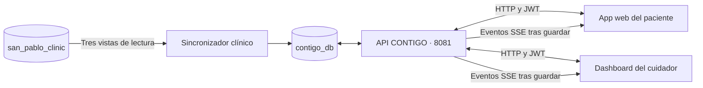

# CONTIGO — clínica ficticia y seguimiento del paciente

El proyecto funciona con **dos bases PostgreSQL independientes**. `san_pablo_clinic` representa una clínica ficticia y conserva historia clínica, diagnósticos, recetas y citas. `contigo_db` guarda la información importada, usuarios y vínculos, respuestas de toma, mediciones domésticas, existencias y auditoría de CONTIGO.

La app web del paciente y el dashboard del cuidador usan la misma API central. Funcionan desde navegadores y dispositivos distintos; no dependen de compartir IndexedDB. Todos los pacientes, profesionales y documentos del caso son sintéticos. No existe una conexión con una institución real.



## Caso de Dacio Ramos

- Paciente central: `pat_001`; identidad clínica externa: `demo-pat_001`.
- La historia de Dacio contiene atenciones, diagnósticos explícitos, una receta firmada por un profesional ficticio y horarios de sus medicamentos. El caso reutiliza Losartán y Vitamina D3 como datos de prueba.
- Cada medicamento importado conserva el diagnóstico y el médico de su receta. La aplicación **no deduce ni prescribe tratamientos a partir del diagnóstico**.
- La app muestra la próxima dosis, permite declarar o corregir tomas, registrar presión/pulso opcional/peso y consultar las citas futuras de la clínica.
- El cuidador consulta a Dacio, recetas, citas, ficha clínica, adherencia, mediciones e inventario. No puede responder una toma por él ni prescribir.
- Rosa Martínez (`pat_002`) permite comprobar el aislamiento entre pacientes.

## Arranque en Windows

Requisitos: Java 21, Node.js 22.12+ o 24 y Maven 3.9. El lanzador encuentra Maven en PATH o en la caché de Maven Wrapper del usuario. PostgreSQL portable se descarga del distribuidor enlazado por [postgresql.org](https://www.postgresql.org/download/windows/) si no está disponible en la caché de CONTIGO.

Desde esta carpeta:

```powershell
npm.cmd ci --prefix frontend
powershell.exe -NoProfile -ExecutionPolicy Bypass -File tools/runtime/Start-Project.ps1 -Rebuild
```

El lanzador crea las bases y sus usuarios, aplica los scripts clínicos de forma idempotente, compila el backend, ejecuta las migraciones de CONTIGO y arranca los servicios sin ventanas auxiliares. En los siguientes arranques se puede omitir `-Rebuild` si el JAR ya está actualizado.

| Componente | Dirección |
| --- | --- |
| Aplicación y acceso | http://127.0.0.1:3001/login |
| Portal de la clínica ficticia | http://127.0.0.1:3001/clinic |
| Salud de la API | http://127.0.0.1:8081/api/v1/health |
| Documentación de la API | http://127.0.0.1:8081/swagger-ui.html |
| PostgreSQL local | `127.0.0.1:55432` |

El puerto 8080 se deja disponible para otros proyectos. PostgreSQL y el backend escuchan en `127.0.0.1`; Vite escucha en `0.0.0.0:3001` y envía `/api/v1` al backend local mediante proxy.

Para abrir la app en un teléfono conectado a la misma red, usar `http://IP-DE-ESTA-PC:3001/login`. El lanzador imprime las direcciones de la computadora. `localhost` en el teléfono apunta al propio teléfono, por lo que debe usarse la IP de la PC. La red y el firewall deben permitir el acceso al puerto 3001. Esta es una ejecución de desarrollo en la red local, no un despliegue público.

### Cuentas de prueba

| Rol | Correo | Contraseña de prueba |
| --- | --- | --- |
| Cuidador de Dacio y Rosa | `cuidador@contigo.example` | `Contigo2026!` |
| Paciente Dacio | `dacio@contigo.example` | `Contigo2026!` |
| Paciente Rosa | `rosa@contigo.example` | `Contigo2026!` |
| Administrador de importación clínica | `admin@contigo.example` | `Contigo2026!` |

El modo de proyecto usa `VITE_USE_MOCKS=false` y `VITE_API_BASE_URL=/api/v1`, ya configurados en `frontend/.env`. Si la API no está disponible, se muestra el error; no se sustituyen los datos por mocks. El modo offline anterior puede activarse explícitamente con `VITE_USE_MOCKS=true` y es independiente de las bases centrales.

Las contraseñas de PostgreSQL y el secreto JWT se generan localmente en `.runtime/local-config.json`, excluido de Git. Los datos persistentes están en `.runtime/postgres-data`. El lanzador puede recibir `-JavaHomePath` y `-MavenCommand`; `Start-Database.ps1` admite `-PostgresBin` o `CONTIGO_PG_BIN` si se dispone de otra instalación de PostgreSQL.

Para detener únicamente los procesos de este proyecto sin borrar los datos:

```powershell
powershell.exe -NoProfile -ExecutionPolicy Bypass -File tools/runtime/Stop-Project.ps1
```

## Base de la clínica

La estructura contiene 32 tablas: organizaciones, sedes, especialidades, médicos, pacientes, contactos, alergias, seguros, historias clínicas, atenciones, diagnósticos, catálogos de medicamentos, recetas, ítems y horarios, citas, observaciones, exámenes y resultados, servicios, facturas, pagos y auditoría.

Hay claves foráneas, restricciones de estado y cantidades, índices de consulta, protección contra cruces entre pacientes/organizaciones y auditoría de cambios. Las alergias desconocidas se registran como desconocidas. Un resultado de examen pendiente no se inventa.

- [Estructura, datos y consultas de la clínica](clinic-db/README.md).
- [Modelo de entidades y relaciones](clinic-db/ER.md).
- SQL de creación: `clinic-db/001_schema.sql`.
- Datos iniciales: `clinic-db/002_seed.sql`.
- Contrato de integración: `clinic-db/003_integration_views.sql`.

Los scripts conservan las modificaciones posteriores: el seed no sobrescribe registros ni renueva fechas en cada arranque. Una receta o cita puede vencer con el paso del tiempo y debe actualizarse expresamente en la fuente clínica.

## Sincronización y responsabilidades

CONTIGO consulta exclusivamente `clinic.contigo_prescriptions`, `clinic.contigo_appointments` y `clinic.contigo_profiles` con una cuenta de servicio que no puede modificar la clínica ni leer sus tablas directamente. La autorización del paciente corresponde al backend de CONTIGO; no se entregan credenciales de bases de datos al navegador.

El lanzador activa el modo `database` y sincroniza al arrancar y cada 15 segundos. También existe `POST /api/v1/clinical-sync/{patientId}`, exclusivo para administradores autorizados. Los datos importados y el estado de éxito se confirman juntos en CONTIGO. Una caída de la fuente conserva la última información importada y deja un estado de fallo visible, con reintento posterior.

Las recetas clínicas tienen versiones. Un cambio de receta cancela las dosis futuras pendientes afectadas y conserva el historial de respuestas; una nueva importación no duplica citas ni tomas. Las suspensiones y cancelaciones se indican expresamente en la fuente. El adaptador actual admite pautas diarias con horarios fijos (`DAILY`); no convierte pautas semanales o a demanda en dosis diarias.

Las mediciones del hogar se escriben en CONTIGO con procedencia `HOME`; no alteran las mediciones oficiales de la clínica. Los eventos SSE se publican después de confirmar los datos, para actualizar el dashboard y la app. El paciente y el cuidador tienen sesiones JWT independientes.

Detalles de configuración, permisos, estados y transacciones: [integración del backend](backend/CLINIC-INTEGRATION.md).

El `docker-compose.yml` original conserva una alternativa de infraestructura básica. El flujo completo de dos bases probado en este equipo es el lanzador de Windows; no ejecutarlo simultáneamente contra instalaciones o volúmenes distintos esperando que compartan los mismos datos.

## Verificación

```powershell
# Frontend
npm.cmd test --prefix frontend
npm.cmd run lint --prefix frontend
npm.cmd run build --prefix frontend

# Backend: ejecutar Maven con JAVA_HOME apuntando a Java 21
cd backend
mvn.cmd test
cd ..

# Restricciones de la base clínica (operaciones de prueba con ROLLBACK)
powershell.exe -NoProfile -ExecutionPolicy Bypass -File clinic-db/Verify-Clinic.ps1

# Flujo integrado con los servicios activos y Playwright disponible en tools/apf3
node tools/runtime/verify-integration.mjs
```

La prueba integrada utiliza cuentas sintéticas, registra una medición y una respuesta de toma cuando hay dosis pendientes cuyo horario ya llegó, comprueba los datos directamente en PostgreSQL, los permisos y la actualización entre dos navegadores aislados. Modifica temporalmente una indicación de prueba en la clínica para comprobar la propagación y la restaura incrementando su versión. Su recibo y capturas se guardan en `output/integration/`. No debe ejecutarse sobre datos ajenos al caso sintético de este proyecto.

Los documentos del avance APF3 están en `output/apf3/`. Las capturas y auditorías de etapas anteriores describen la interfaz y el modo de datos de sus respectivas fechas; no son evidencia de esta integración posterior.
