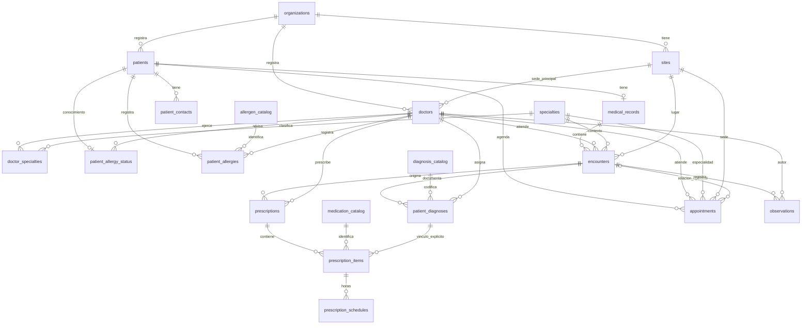
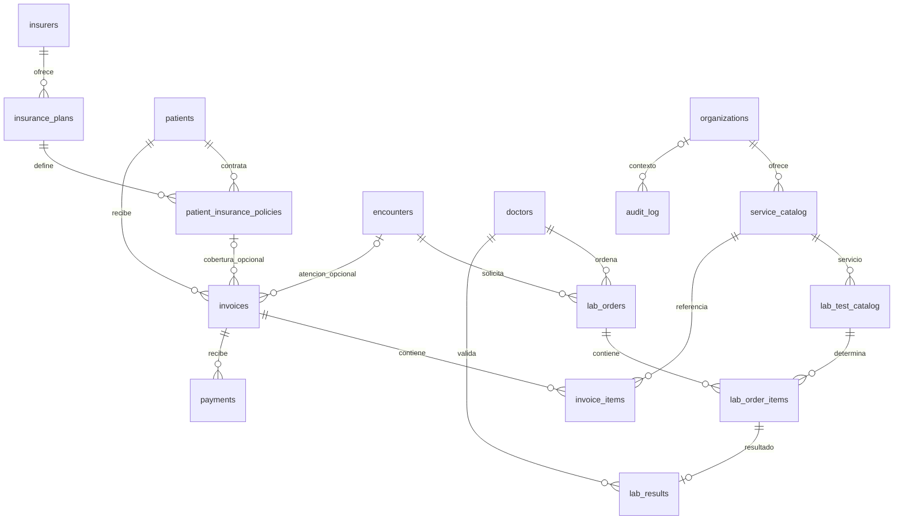
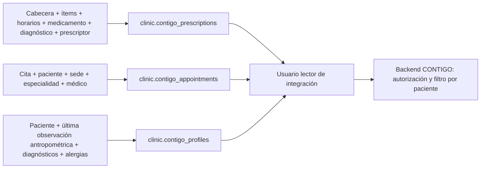

# Modelo entidad–relación

El modelo separa identidades, hechos clínicos, indicaciones prescritas y operaciones administrativas. Los identificadores internos enlazan entidades; los identificadores externos estables permiten sincronizar con CONTIGO. Una receta contiene varios ítems y cada ítem varias horas: no se almacena una lista CSV como fuente transaccional. El CSV se construye únicamente en la vista de integración.

## Personas y atención clínica

Las relaciones marcadas `o|` son opcionales. La base permite crear una historia antes de su primera atención y una receta antes de cargar sus ítems; la validación del flujo completo debe comprobar que estén listos antes de publicarlos. La relación diagnóstico–ítem es una elección registrada por un profesional ficticio, no un motor de inferencia.

## Exámenes, seguro y facturación

Los catálogos de especialidades, diagnósticos, medicamentos y alérgenos son compartidos. Sedes, profesionales, pacientes, servicios y documentos pertenecen a una organización. Las entidades dependientes usan claves compuestas para conservar ese contexto y, cuando corresponde, el mismo paciente. La auditoría incluye las modificaciones de los catálogos compartidos, que pueden carecer de organización.

## Claves e invariantes principales

| Grupo | Claves y reglas |
|---|---|
| Identidad | PK estable en cada entidad; `patients.external_patient_id` globalmente único; historia única por paciente; código de sede único por organización |
| Profesionales | Matrícula y externo únicos por organización; PK compuesta de médico–especialidad; cita y atención deben usar una especialidad registrada para el médico |
| Alergias | Una fila de conocimiento por paciente; alérgenos asignados separados de ese estado; `UNKNOWN` conserva falta de información |
| Clínica | Historia, atención, diagnóstico y paciente relacionados por FK; códigos diagnósticos en catálogo; diagnóstico de receta verificado contra paciente mediante trigger |
| Prescripción | Cabecera con vigencia y prescriptor; identidad externa de ítem única por organización; dosis positiva; versión positiva; hora diaria o día/hora semanal sin duplicados |
| Agenda | Final posterior al inicio; inicio programado único por médico y por paciente; zona conservada como instante `timestamptz` |
| Observaciones | Valor al menos en una magnitud; talla/peso positivos y acotados; presión como par sistólica/diastólica con sistólica mayor; nulos conservan datos desconocidos |
| Laboratorio | Orden y detalle separados; un resultado por detalle; exactamente un valor numérico o textual; rangos opcionales sin interpretación clínica automática |
| Administración | Póliza por paciente; porcentaje entre 0 y 100; líneas y pagos positivos; totales derivados, sin duplicar la relación de detalles |
| Auditoría | Secuencia identity; operación, actor, instante, transacción y JSONB; trigger de solo anexado para el uso normal |

## Proyecciones hacia CONTIGO

La proyección financiera `invoice_balances` permanece fuera de los permisos del lector. Las tres vistas del contrato son de solo lectura y conservan los identificadores externos existentes para evitar duplicaciones al importar.
